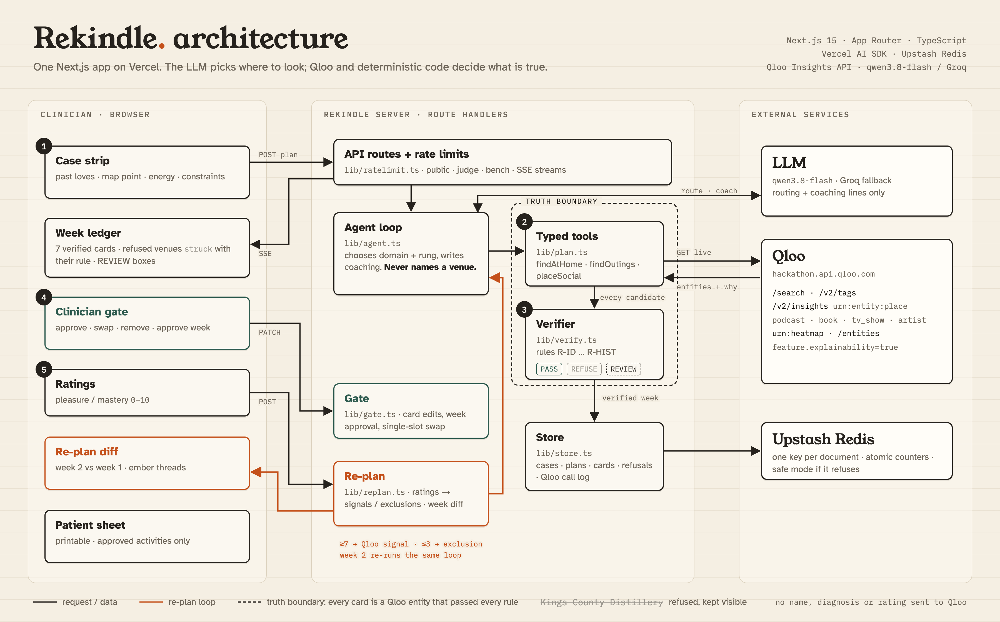
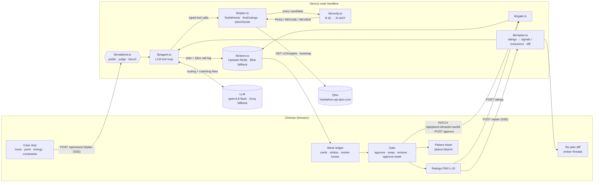

# Architecture

Rekindle is one Next.js 15 app (App Router, TypeScript) on Vercel. The UI and the API routes are in the same deploy.
The section between the `generated` markers below is rebuilt from the source tree by `python3 scripts/architecture.py`.
`npm run check` fails if that section no longer matches the code (`architecture.py --check`).

## The one flow

<b>The one flow as a Mermaid diagram</b> (click to expand)

## Truth boundary

The model chooses where to look. Qloo and deterministic code decide what is true.

- **The model routes; it never names a venue.** The tools (`lib/agent.ts`) take a day, an at-home type, an optional slot hour and an optional `narrowMeters`.
  Constraints never come from the model:
  - radius, price cap, recovery, quiet and wheelchair are read from the stored case on every request (`outingParams` in `lib/plan.ts`);
  - `narrowMeters` can only tighten the radius.
  - If the narrowed query verifies nothing, `findOutings` retries once at the case radius before it leaves the slot empty.
- **Every card is a Qloo entity returned in that run.** It passed every rule in `lib/verify.ts` against the case row. A refused candidate stays on the sheet, struck through, with its rule.
  An ambiguous candidate goes to a REVIEW box for the clinician and is never placed.
- **The model writes one coaching line per card.** Qwen and Groq race for it in one window after routing (`coachRace` in `lib/agent.ts`); the first valid answer wins. Each line is checked (R-ID, length, facts, other names, drinking, and the card's dose; drops are stored as `dropped` on the plan). Cards a constraint toggle refilled get one short raced call of their own. A swap, and any card whose line was dropped or did not arrive in time, uses a template line and says "coaching: template".
- **Qloo down = the slot stays empty, with the reason.** The model never fills a slot on its own (`qlooDown` in `lib/plan.ts`).

## Qloo usage

- **At-home doses:** `/v2/insights` with `filter.type=urn:entity:{artist,podcast,book,tv_show}`, the patient's loves as `signal.interests.entities` / `.tags`, `feature.explainability=true`.
- **Solo outings:** `/v2/insights` `filter.type=urn:entity:place` with `filter.location` (WKT POINT) + `filter.location.radius`, `filter.hours=<day>`, `filter.price_level.max`,
  `filter.tags` (+ `operator.filter.tags=intersection` for quiet + wheelchair), `filter.exclude.tags` (14 alcohol tags when in recovery), `filter.exclude.entities` (already on the sheet, or rated ≤3).
- **Social outing:** a `urn:heatmap` query (`output.heatmap.boundary=urn:geohash`). The top-affinity cell feeds `filter.location.geohash`, with POINT fallbacks at the cell centre.
- **Intake:** `/search` pinned by `types` for entity loves; `/v2/tags` for food and activity loves (`lib/resolve.ts`).
- **Bench only:** `/search` with `filter.location` + `filter.radius` to grade a named venue (`lib/venue.ts`), after a Nominatim geocode.
- **Explainability:** the weights for her entity loves become every card's "because" line (tag loves such as ramen shape the ranking but get no weight; DX-REPORT §7).
- **Week 2:** ratings ≥7 join the signals and ratings ≤3 join the exclusions (`lib/replan.ts`).

The Qloo friction we hit, with repro commands, is in [DX-REPORT.md](DX-REPORT.md).

## Persistence, limits, observability

- **Store** (`lib/store.ts`): one zod-validated JSON document per case, per plan, and per plan's Qloo call log.
  - Backend precedence: Upstash Redis when `KV_REST_API_URL` + `KV_REST_API_TOKEN` are set (one key per document, `SET NX` / compare-and-set run claims, a newest-first sorted set of plan ids instead of a `list()`), else a private Vercel Blob store, else in memory locally. `STORE_BACKEND=blob` is the rollback; it refuses to start on Vercel with no store. Both backends pass one contract suite (`tests/store-contract.test.ts`, Redis on an in-process fake).
  - Why Redis: Vercel Hobby allows 2,000 Blob advanced operations per rolling 30 days and suspends the store for 30 days past that.
  - **Safe mode:** when the backend refuses (suspended, over quota, 5xx, network), the instance opens a 5-minute circuit and keeps planning live on its own memory under a banner that says the week is not saved. A saved week that cannot be read is "unavailable right now" (a page, or a 503 with `retry-after`), never "Not found" and never a 500.
  - Bench requests (`x-bench-token`) read and write under a `bench/` prefix (`lib/scope.ts`).
- **Rate limits** (`lib/ratelimit.ts`): three namespaces.
  - **public:** per-IP hourly limit + a global daily cap.
  - **judge:** `/?judge=<token>` sets a cookie (`middleware.ts`). It has its own quota and never counts against the public cap.
  - **bench:** `x-bench-token`.
  - The per-IP window is in memory per instance and also meters the saved-week pages and the receipts (zero store reads when refused). The daily plan counter follows the store: an atomic Redis `INCR`, else a Blob document; if it cannot be read, the cap is counted on the instance instead. Defaults and overrides are in [`.env.example`](.env.example).
- **Receipts:** every Qloo request of a plan is stored without the key (path, params, status, ms, result count). It is shown on `/integrations/qloo` and summarised on `/judge`.
- **Health:** `GET /api/health` makes one Qloo `/v2/tags` call and one LLM ping; `?deep=1` adds one store probe: a Redis `PING`, or on Blob one `head()` (a billed simple op on Vercel Hobby, so only an hourly monitor should use it). The body names the store (`redis` / `blob` / `memory`) and whether the instance is in safe mode. Each depth is cached for 60 s per instance, and the endpoint returns 503 when any probe is down.

## Failure and edge states

| State | Where it comes from | What the sheet shows |
|---|---|---|
| Loading | SSE `tool` events while `runAgent` works | pencil-sketch lines per day, cards pencilled in as tools return |
| Refused | `verifyCard` → REFUSE | the candidate struck through in its slot, rule + detail beneath (one strike per venue per day) |
| REVIEW | `verifyCard` → REVIEW (e.g. bar seating alone, in recovery) | a dashed box: the clinician decides, never placed automatically (max 2 per slot) |
| Empty | no candidate passed, or the clinician removed one | the slot left empty with the reason |
| Coverage refusal | outing slots empty at the case radius | how many outings verified, why each slot is empty, "Widen to N km with clinician consent" |
| Qloo unavailable | a Qloo error during a tool call | solid empty slot + banner; `/judge` has a labelled demo (`?fault=qloo_unreachable`) that sends no request and is excluded from receipts |
| Store unavailable | the store refuses (`StoreUnavailable`: Blob suspended, Redis over quota, 5xx, network) | new weeks still plan live from per-instance memory under a "Storage is paused" banner; saved weeks render "unavailable right now"; the API answers 503 + `retry-after` (`STORE_FAULT=unavailable` reproduces it off production, `e2e/safe-mode.spec.ts`) |
| Too many page reads | the per-IP `read` window (in memory) | "Too many requests, try again in N min", with nothing read from the store |

## Generated from the code

<!-- generated:start -->
_Generated by `python3 scripts/architecture.py` from the source tree. Do not edit by hand; re-run it._

### HTTP routes

| Method | Path | What it does (from the route's doc comment) |
|---|---|---|
| POST | `/api/cases/:id/copy` | "Copy this case": a visitor viewing someone else's (read-only) case gets a fresh case with the same fictional intake (loves, point, energy, constraints), owned by them |
| POST | `/api/cases/:id/plan` | run the agent for week 1, live against Qloo, and stream it as Server-Sent Events: open → start → qloo* / llm* / tool* (as they happen) → truth_boundary? → plan (the … |
| GET | `/api/cases/:id` | the stored case: loves, neighbourhood point, energy and constraints |
| POST | `/api/cases` | intake |
| POST | `/api/cases/seed/:slug` | clone a fictional seeded profile (inputs only) into a fresh case for this visitor |
| GET | `/api/health` | Qloo + LLM liveness for the uptime pinger (?deep=1 also probes the store): 200 when all answer, 503 otherwise |
| POST | `/api/plans/:id/approve` | the clinician gate (I4): stamps every card on the draft week and locks it |
| PATCH | `/api/plans/:id/cards/:cardId` | one clinician action on one card of a draft week: approve / unapprove / remove, or swap (re-runs that one slot live through the same tool + verifier, with everything … |
| POST | `/api/plans/:id/constraints` | a constraint tab was toggled |
| POST | `/api/plans/:id/ratings` | pleasure / mastery 0–10 for approved cards of an approved week |
| POST | `/api/plans/:id/replan` | week N+1 from the ratings, live (same agent loop, tools and verifier as week 1), streamed as Server-Sent Events like the week-1 plan: open → start → qloo* / llm* / tool* … |
| GET | `/api/plans/:id` | the stored week (and, on request, its Qloo call log: path, params, status, ms; never the key) |
| GET | `/api/resolve` | GET /api/resolve?text=Phoebe%20Bridgers&kind=artist → top 3 Qloo candidates for the clinician to confirm |
| POST | `/api/verify-venue` | bench only (bench token; its own quota, never the public or judge caps) |

### Pages

| Page | Source |
|---|---|
| `/cases/:id` | `app/cases/[id]/page.tsx` |
| `/cases/new` | `app/cases/new/page.tsx` |
| `/integrations/qloo` | `app/integrations/qloo/page.tsx` |
| `/judge` | `app/judge/page.tsx` |
| `/` | `app/page.tsx` |
| `/plans/:id` | `app/plans/[id]/page.tsx` |
| `/plans/:id/print` | `app/plans/[id]/print/page.tsx` |

### Modules

| Module | Lines | Role (first sentence of its header comment) |
|---|---|---|
| `lib/agent.ts` | 570 | Agent loop |
| `lib/gate.ts` | 257 | The clinician gate and the ratings loop |
| `lib/health.ts` | 106 | Liveness (`GET /api/health`): one cheap Qloo `/v2/tags` call and one tiny LLM ping |
| `lib/http.ts` | 71 | Small helpers for the route handlers: JSON responses, error mapping, and a Server-Sent Events stream |
| `lib/intake.ts` | 81 | Server-side check of the loves an intake POST claims the clinician confirmed (QA round 3: the route trusted the client — duplicates, made-up IDs that were then sent to … |
| `lib/judge.ts` | 225 | /judge view model: the bench table, ablation, re-plan responsiveness and the manual audit, read from the committed files that scripts produce (bench/results.json ← … |
| `lib/llm.ts` | 68 | LLM providers for the agent loop (OpenAI-compatible endpoints via the Vercel AI SDK) |
| `lib/owner.ts` | 63 | Case ownership without logins |
| `lib/plan.ts` | 600 | Plan core — the deterministic half of the agent |
| `lib/qloo.ts` | 298 | Qloo client — typed GET wrapper for the hackathon API |
| `lib/ratelimit.ts` | 288 | Rate limiting |
| `lib/reads.ts` | 41 | Request-scoped document reads for server components |
| `lib/receipts-cached.ts` | 29 | a2a r06 (Vercel Hobby budget): /judge and /integrations/qloo are force-dynamic and crawlable, and the "latest plans" view runs a store list() — on Blob an ADVANCED op, … |
| `lib/receipts.ts` | 100 | Receipts for /integrations/qloo: the Qloo requests behind the most recent plans, read from the stored call logs (path, params, status, ms, result count — never the key, … |
| `lib/replan.ts` | 137 | Re-plan math (deterministic) |
| `lib/resolve.ts` | 56 | resolveLove — intake resolution of a typed love to Qloo IDs (used by /api/resolve, the same rule as scripts/seed.py) |
| `lib/scope.ts` | 11 | Which store a request reads and writes |
| `lib/service.ts` | 332 | Server-side orchestration shared by the API routes and scripts: seeded-case cloning, intake, and running the agent for a stored case with its Qloo call log persisted … |
| `lib/store.ts` | 843 | Persistence |
| `lib/tags.ts` | 29 | Tag constants |
| `lib/venue.ts` | 191 | Venue verification for the bench (`/api/verify-venue`) |
| `lib/verify.ts` | 449 | Deterministic verifier — the truth layer |
| `lib/view.ts` | 436 | Pure view helpers for the week ledger |

### Verifier rules

| Rule | Check (from `lib/verify.ts`) |
|---|---|
| `R-ID` | has a Qloo entity_id (and, when given, one returned by Qloo in this run) |
| `R-OPEN` | open at the slot per properties.hours[day] (overnight wrap handled; null hours = UNKNOWN = refused) |
| `R-NEAR` | query.distance ≤ case max_meters |
| `R-PRICE` | properties.price_level ≤ case price_max (when Qloo reports a price level) |
| `R-ALC` | in recovery: exact deny-listed tag IDs + token screen with an allow list; ambiguous → REVIEW |
| `R-KIND` | the place is a behavioural-activation activity category (museum, park, café, restaurant, studio…) |
| `R-QUIET` | need_quiet → carries noise_level:qloo:quiet |
| `R-ACCESS` | need_wheelchair → carries accessibility:place:wheelchair_accessible_entrance |
| `R-HIST` | not previously rated ≤ 3, and not swapped out / removed by the clinician in an earlier week |

### Agent tools and Qloo surface

Tools offered to the model (`lib/agent.ts`): `findAtHome`, `findOutings`, `placeSocial`, `submitPlan`.

Plan loop (plan, re-plan, swap, constraint toggle; `lib/plan.ts`, `lib/gate.ts`): 15 distinct Qloo parameters to `/entities`, `/v2/insights`: `entity_ids`, `feature.explainability`, `filter.exclude.entities`, `filter.exclude.tags`, `filter.hours`, `filter.location`, `filter.location.geohash`, `filter.location.radius`, `filter.price_level.max`, `filter.tags`, `filter.type`, `operator.filter.tags`, `output.heatmap.boundary`, `signal.interests.entities`, `signal.interests.tags`.

Intake (`lib/resolve.ts`, `lib/intake.ts`), health (`lib/health.ts`) and the bench-only venue grader (`lib/venue.ts`) add `/search`, `/v2/tags` and 4 more parameters: `filter.query`, `filter.radius`, `query`, `types`.

In all: 19 distinct parameters to 4 endpoints (`/entities`, `/search`, `/v2/insights`, `/v2/tags`). Page-size and pagination keys (`take`, `page`, `offset`) are not counted, here or on /integrations/qloo.
<!-- generated:end -->
