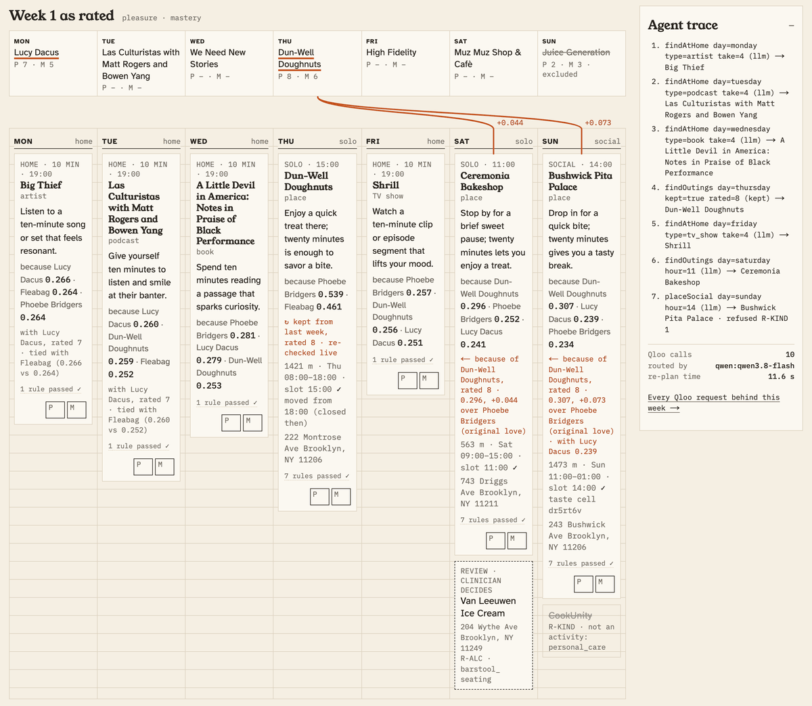
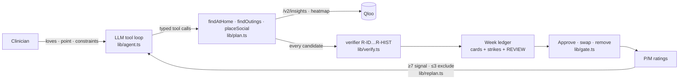

<div align="center">
  
  <h1>Rekindle 🕯️</h1>
  <p><b>A behavioural-activation planning agent for clinicians.</b><br>
  It turns what a depressed patient used to love into a week of real, open, nearby activities, verified with Qloo, approved by the clinician, and re-planned from the patient's own pleasure ratings.</p>
  

  <br/>

  [](https://rekindle-one.vercel.app)
  [](https://rekindle-one.vercel.app/judge)
  [](https://qloo.devpost.com/)

  <br/>

  
  
  
  
  
  [](LICENSE)
  [](https://github.com/edycutjong/rekindle/actions/workflows/ci.yml)
  [](https://github.com/edycutjong/rekindle/actions/workflows/codeql.yml)
  [](https://github.com/edycutjong/rekindle/releases/latest)

  <p>
    <a href="https://rekindle-one.vercel.app"><b>Try it live: rekindle-one.vercel.app</b></a> (no login, fictional cases) ·
    <a href="JUDGE.md">For judges</a> ·
    <a href="DEMO.md">Demo steps + bench</a> ·
    <a href="DX-REPORT.md">Qloo DX report</a> ·
    <a href="ARCHITECTURE.md">Architecture</a>
  </p>
</div>

---

## 🎯 The number

<!-- bench:killer:start -->
**73.4% vs 9.1% through the same address pipeline** (0.0% when Rekindle's cards are checked by their Qloo ID). Across 20 fictional profiles, 58 of 79 outing venues in plans from the same LLM asked for named places were wrong: 48 unverifiable, 9 closed at the slot, 1 serving alcohol to a patient in recovery. Rekindle: 6 of 66 through the same pipeline (all 6 unverifiable, i.e. geocode or name-match misses on venues Qloo verified), 0 of 66 by Qloo ID (`bench/results.json`, run 2026-10-07 13:11 UTC). Manual audit against public listings (a sample of 20 venues per arm; not blind, done by the build agent): **41.2% vs 0.0%** (7 of 17 checkable vs 0 of 14; 3 and 6 inconclusive, `bench/audit.json`).
<!-- bench:killer:end -->

<!-- bench:caveat:start -->
**Caveat: this bench run predates 16 later changes to the plan path** (listed in [DEMO.md](DEMO.md#bench-reproduce)). Every bench number on this page, latency included, was measured before them; the bench is re-run on the final deploy before submission.
<!-- bench:caveat:end -->

The rest of the bench is in [DEMO.md](DEMO.md#bench-reproduce): the full table, the B-sym noise floor, the alcohol-screen ablation, latency, and re-plan responsiveness. It also says how to read it. Qloo grades both arms, and the manual audit was not blind.

## 🔍 For judges

- **Click path (about 4 min):** [DEMO.md](DEMO.md). The short version: open the live app → **Plan Maya's week, live** → toggle **In recovery** → **swap** a card → **Approve week** → rate 3 cards → **Re-plan week 2** → **Patient sheet**.
- **Receipts:** [`/judge`](https://rekindle-one.vercel.app/judge). It has the six edge states with live start buttons (loading, refused, REVIEW, empty, coverage refusal, Qloo unavailable), plus the bench, ablation and re-plan N/N, all read from the committed `bench/*.json`.
- **Nothing on the default path is replayed.** Every plan, re-plan, swap and toggle calls Qloo live; plans and re-plans also call the routing model. Captured Qloo responses are used only in unit tests (`tests/replay.ts`).
- **One page for you:** [JUDGE.md](JUDGE.md) mirrors `/judge`: the claim, a 30-second path, the receipts, the real reproduce command and the limitations.

## 💡 The Problem & Solution

### The Problem

Behavioural activation (BA) is a first-line, low-cost treatment for depression. Its core step is **activity scheduling**: plan specific pleasant activities for specific times, then rate them. That step breaks where it matters most:

- **Anhedonic patients cannot name anything they would enjoy**, so the session goes to brainstorming.
- **Generic suggestions** ("go for a walk") do not stick.
- When a clinician does name a real place, **nobody checks** that it is open at the planned hour, close enough for a low-energy day, within budget, quiet enough, or alcohol-free for a patient in recovery.

### The Solution

1. **Intake.** The clinician enters 3–6 things the patient loved before the illness. Each is resolved to a Qloo entity or tag, typed so the clinician can tell them apart. The clinician also sets a neighbourhood point, an energy level and constraints (*in recovery*, *quiet*, *wheelchair entrance*, distance, budget).
2. **A graded week, built by an agent.** An LLM tool loop works through an energy ladder: 10-minute at-home doses (an artist, podcast, book or show), then solo outings, then one social outing placed in the top-affinity taste cell near the patient, taken from a Qloo heatmap.
   The model picks *where to look* and writes one coaching line per card. **It never names a venue.**
3. **Every candidate is verified.** Deterministic rules check what Qloo returned: open at the slot, near, within budget, an activity category, alcohol-free in recovery (exact tags plus a token screen), quiet or accessible when required, and not rated low before.
   Refused candidates **stay on the sheet, struck through, with their rule**. Ambiguous ones go to the clinician in a dashed REVIEW box.
4. **The clinician gate.** Approve, swap (re-runs that one slot live) or remove each card, then **Approve week**. Nothing reaches the patient without approval. A patient sheet prints only the approved activities.
5. **Ratings → re-plan.** Pleasure and mastery are rated 0–10. A rating ≥7 becomes a Qloo signal for week 2, and a rating ≤3 becomes an exclusion. The diff draws an ember thread from a rated activity to a week-2 card only where Qloo's explainability names it as the strongest input by at least 0.02; a narrower lead is labelled a tie. The top-rated activity itself comes back in its slot ("↻ kept") after a live re-check.

Every card carries a **because** line with Qloo's per-love explainability weights, for example "because Phoebe Bridgers 0.54 · Fleabag 0.46".

## 🏗️ Architecture & Tech Stack



- **Next.js 15** (App Router, TypeScript) on Vercel. The UI and API routes are one deploy, and week plans stream to the browser as Server-Sent Events.
- **Agent:** Vercel AI SDK `generateText` with typed zod tools. The model is `qwen3.8-flash` on DashScope-intl with thinking off; Groq `openai/gpt-oss-120b` takes over routing on a provider error or timeout. The coaching lines are a race: both providers get the same forced call in a 6 s window after the 20 s routing budget, and the first valid answer wins. Cards a constraint toggle refilled get one short raced call (4 s). A swapped-in card, a card whose line breaks a truth-boundary rule, and a card with no line in time get a template coaching line and say "coaching: template".
  Constraints never come from the model: radius, price, recovery, quiet and wheelchair are applied from the stored case on every request.
- **Store:** a private Vercel Blob store (one zod-validated JSON document per case, plan, and plan call log); in memory for local development.
- **Rate limits:** public / judge / bench namespaces, so judges are never locked out and the bench never touches the public quota.

Full detail, with route, module and rule tables generated from the code: [ARCHITECTURE.md](ARCHITECTURE.md).

| Layer | Technology |
|---|---|
| **App** | Next.js 15 (App Router, TypeScript, React 19), Server-Sent Events for streamed week plans |
| **Agent** | Vercel AI SDK `generateText` with typed zod tools; `qwen3.8-flash` (DashScope-intl), Groq `openai/gpt-oss-120b` as fallback and coaching-race runner |
| **Truth layer** | Deterministic verifier `lib/verify.ts` (R-ID … R-HIST), no I/O |
| **Data** | Qloo Insights API (`/v2/insights`, heatmap, `/entities`, `/search`, `/v2/tags`) |
| **Store** | Private Vercel Blob (zod-validated JSON documents); in memory locally |
| **Hosting** | Vercel |

## 🏆 Qloo Integration: why Qloo is the engine

Without Qloo, the plan is an LLM naming venues it cannot verify. In the bench, the same model asked for named places produced the arm-A row of the table above.

Rekindle depends on these parts of the Qloo API:

- `/v2/insights` place queries with `signal.interests.entities` / `.tags`, `filter.location` (WKT POINT) + `filter.location.radius`, `filter.hours`, `filter.price_level.max`, `filter.tags` + `operator.filter.tags`, `filter.exclude.tags`, `filter.exclude.entities`, `feature.explainability`;
- `urn:heatmap` with `output.heatmap.boundary=urn:geohash` → `filter.location.geohash` for the social outing;
- four at-home entity types;
- `/entities` to re-check, live, the enjoyed activity a re-plan keeps in its slot;
- `/search` and `/v2/tags` at intake ([`/cases/new`](https://rekindle-one.vercel.app/cases/new)).

<!-- arch:qloo:start -->
The plan loop (every plan, re-plan, swap and toggle) can send up to 15 distinct Qloo parameters to `/entities` and `/v2/insights`; which ones a given plan sends depends on its constraints (quiet and wheelchair add `filter.tags`, a re-plan adds `/entities`), and [`/integrations/qloo`](https://rekindle-one.vercel.app/integrations/qloo) counts what the latest live plans actually sent. Intake, the health check and the bench grader add `/search` and `/v2/tags` and 4 more parameters (19 in all, to 4 endpoints). Both lists are generated from the code in [ARCHITECTURE.md](ARCHITECTURE.md#agent-tools-and-qloo-surface).
<!-- arch:qloo:end -->

The Qloo requests behind the latest plans (or any one plan, via `/integrations/qloo?plan=<id>`) are shown on [`/integrations/qloo`](https://rekindle-one.vercel.app/integrations/qloo), without the key. Intake lookups (`/search`, `/v2/tags`) are not logged there.

## 📊 Engineering Rigor

| Metric | Value | Source |
|---|---|---|
| Unit + property tests | **178** (Vitest, 14 files), no keys needed | `npm test` |
| Generated verifier cases | **60,000** (3 properties × 20,000, fixed seeds) | `tests/verify.property.test.ts` |
| Tests named for the defect they pin | 36 (probes P8–P23, bench B5 / D9, QA rounds 1–3, COACH-* rules) | `tests/*.test.ts`, counted by `scripts/rigor.py` |
| Coverage (`lib/`, API routes) | 92.7% lines · 79.9% branches | `npm run test:coverage` (CI uploads the report) |
| E2E | Playwright, keyless in CI (desktop + Pixel 7); `scripts/ui_smoke.py` runs 18 gates against the live deploy | `e2e/`, `scripts/` |
| Lighthouse (/, /judge, /cases/new, desktop) | 97–100 performance · 100 accessibility · 100 best practices · 100 SEO in the CI runs for 6672043, cdb9070 and 73be59e (100 on all three pages except performance 97 on / at 6672043) | CI Stage 5: [run 37660324552](https://github.com/edycutjong/rekindle/actions/runs/37660324552) (73be59e); later runs write the scores to the job summary and keep the LHR JSON as a 90-day `lighthouse` artifact. Thresholds in `lighthouserc.json`; accessibility < 0.9 fails |
| Plan latency, hosted | p50 17.43 s · p95 20.61 s (bench run; it predates later plan-path changes, see the caveat under The number) | `bench/results.json` |

### Attacks defeated

| Control | Why it is load-bearing | Test |
|---|---|---|
| Any deny-listed alcohol tag refuses an in-recovery outing | 14 exclusion tags alone still let alcohol-tagged places through (P19) | `tests/verify.property.test.ts:109` (20,000 cases), `tests/verify.test.ts:101` |
| Alcohol screen matches whole tokens, never substrings | a substring screen refuses `espresso_bar` and `independent_publishing` | `tests/verify.test.ts:128` |
| Drinking-establishment categories are refused for every case | "TeKu Tavern + Café" passed as a café (B5 bench) | `tests/verify.test.ts:174` |
| Missing opening hours are refused, never assumed open | an unknown hour would put a patient outside a closed door | `tests/verify.test.ts:39`, property P3 |
| A coaching line keyed to an ID no tool returned is dropped | the model must never name a venue | `tests/agent.test.ts:102` |
| Drinking language in coaching is dropped on every case | the model never sees the recovery flag (COACH-ALC) | `tests/agent.test.ts:265` |
| Clinical words and contact data are refused before any Qloo request | love-box text is sent to Qloo | `tests/gate.test.ts:404` |
| Fabricated entity IDs and duplicate loves are refused at intake | the client cannot plant a love Qloo never returned | `tests/gate.test.ts:423` |
| Another visitor cannot change a week (403, read-only) | plans carry the creator's httpOnly owner cookie | `tests/gate.test.ts:320` |
| Two concurrent re-plans run one agent run | a double click must not fork week 2 | `tests/gate.test.ts:493` |
| A wrong or short judge/bench token is treated as public | quotas cannot be borrowed | `tests/ratelimit.test.ts:10` |

### Limitations: honest limits (7)

1. **It is not a clinical tool.** It is clinician support only: no diagnosis, no efficacy claims, no patient logins. Every case in the app is fictional. The text typed into an intake love box is sent to Qloo /search or /v2/tags to find matches: the clinician types only the taste (an artist, show, food), and a small deterministic deny list refuses clinical words and contact data before any request (`screenLoveText`, a screen, not a guarantee). Each plan sends taste entities, a map point and constraint filters (for example the alcohol-tag exclusions when "in recovery" is on, which a reader of the requests could take as a proxy for that flag). The case name never leaves the server; the confirmed love's name is Qloo's own.
2. **The plan depends on Qloo's coverage.** In thin areas, outing slots stay empty and the app shows a coverage refusal. It does not guess.
   In the bench, 4 of 20 profiles had too few verified week-1 outings for the re-plan check and are excluded (`bench/replan.json`).
3. **A plan is slow:** p50 is about 17 s from click (see the latency table in DEMO.md). It meets the 30 s gate we set, but not the 15 s we aimed for. The LLM coaching step dominates.
4. **Opening hours come from Qloo.** A venue whose hours are wrong upstream will pass R-OPEN. Missing hours are refused, never assumed open.
5. **The alcohol screen is a deny list.** It is measured (see the ablation), but a venue that serves alcohol and carries none of the tags or keywords would get through.
6. **The ember thread is Qloo's attribution, not causation.** It is drawn when a rated activity is a week-2 card's top-weighted explainability input by at least 0.02. Qloo splits explainability nearly evenly across signals, so on live re-plans most leads are ties (the live distribution is on /judge, from `scripts/ember-margins.ts`).
7. **Not built yet:** free-text address geocoding at intake (seeded neighbourhood points only), the heatmap map tile, mastery-driven rung changes (mastery is recorded and shown, but does not change the plan), multi-clinician use.

### What we got wrong

- **We trusted `filter.exclude.tags` at first.** Excluding four bar tags still left 17 of 25 alcohol-tagged places for Maya's query (DX-REPORT §2). We added a 14-tag set and a deterministic screen, and the ablation now measures what each layer does.
- **We planned a substring alcohol screen.** A probe showed it would refuse `espresso_bar` and `independent_publishing` ("pub"), so R-ALC matches exact tag IDs and whole tokens, with an allow list (`lib/verify.ts`).
- **A beer hall got through.** The bench placed "TeKu Tavern + Café" for a profile not in recovery, because its `cafe` category passed R-KIND. Drinking-establishment categories are now refused for every case (`tests/verify.test.ts`).
- **REVIEW-only venues were being struck as refusals after a constraint toggle.** They now go to the clinician's REVIEW box.
- **The coverage refusal said "within 1.5 km" while the model had narrowed one query to 600 m.** A narrowed query that verifies nothing is now retried once at the case radius, and the empty reason names the radius queried.
- **The manual audit was done by the build agent, so it was not blind.** It is labelled as such everywhere. An external blind audit has been requested.

## 🚀 Getting Started

Requires Node 22 or 24 (the CI matrix; `engines` in package.json) and Python 3 (for the scripts).

```bash
git clone https://github.com/edycutjong/rekindle && cd rekindle
npm ci
cp .env.example .env.local     # fill in QLOO_API_KEY and QWEN_API_KEY (or GROQ_API_KEY with LLM_PROVIDER=groq)
npm run check                  # typecheck + lint + tests + seed check + docs check; needs no keys
npm run dev                    # http://localhost:3000
```

- **Without `BLOB_READ_WRITE_TOKEN`**, plans and rate-limit counters live in memory. Restarting the dev server clears them.
- **The judge and bench quotas** need `JUDGE_TOKEN` / `BENCH_TOKEN` (16 or more characters). Without them, every request uses the public namespace.
- **The Qloo key only works against `https://hackathon.api.qloo.com`.** Every variable is listed in [`.env.example`](.env.example).

## 🧪 Testing & CI

- **178 tests** (Vitest, 14 files) cover the verifier rules against captured Qloo shapes, the agent loop's truth boundary (incl. COACH-ALC, COACH-DOSE and the raced coaching hand-off), intake validation (deny list, re-resolved loves), superseded weeks after a toggle, ember margins, constraint toggles, the clinician gate (its memory across weeks, one re-plan per week, case ownership), re-plan math (incl. the kept activity), rate limits, the store, health, and the view helpers. Three fast-check properties sweep 60,000 generated venues through the verifier.
- `npm run check` runs typecheck, lint, the tests, the seed-data check, and checks that `ARCHITECTURE.md`, the bench numbers in this README, DEMO.md and JUDGE.md, and the test, property-case and coverage numbers still match the code, `bench/*.json` and the suite (`scripts/rigor.py`).
- **End-to-end** (Playwright, logged-out):
  - `e2e/` runs keyless in CI: smoke, `/judge` with no credentials, the keyless refusal (no week is invented) and 375 / 768 / 1440 px layouts; `e2e/live-plan.spec.ts` plans Maya live when `E2E_LIVE=1`.
  - `scripts/ui_smoke.py` drives the whole flow against the live deploy, including the patient sheet and 375 px layouts.
  - `scripts/edge_states.py` checks the six edge states.
  - Both scripts exit 1 on a failed gate.

```bash
# ── no keys needed ─────────────────────────────
npm run check          # typecheck + lint + tests + seed / docs / kitchen checks
npm run test:coverage  # Vitest + v8 coverage
npm run ci             # production-dependency audit + check + coverage
npm run build && npm run e2e         # Playwright, keyless: the app must refuse to plan, never invent a week
npm run build && npm run lighthouse  # Lighthouse CI, accessibility >= 0.9 blocks
make security-scan     # prod npm audit + license allowlist + gitleaks over the full history (fails on any finding)

# ── live: real Qloo + model calls ──────────────
npm run e2e:live                                                             # Playwright live-plan spec
python3 scripts/ui_smoke.py https://rekindle-one.vercel.app /tmp/shots live  # the whole click path, 18 gates
python3 scripts/edge_states.py https://rekindle-one.vercel.app /tmp/shots live
```

**6-stage pipeline** ([`ci.yml`](.github/workflows/ci.yml)): Quality → Security (parallel) → Build → E2E + Performance → Deploy gate. Vercel deploys `main`.

| Layer | Tool | Where |
|---|---|---|
| Code quality | ESLint + `tsc --noEmit` | Stage 1, Node 22 and 24 |
| Unit + property tests | Vitest + fast-check, v8 coverage | Stage 1 |
| Generated-doc drift | `architecture.py`, `bench_table.py`, `rigor.py` (test, property-case and coverage numbers), `kitchen_check.py` | Stage 1 |
| Secret scanning | gitleaks over the full history, GitHub secret scanning + push protection | Stage 2, weekly |
| Dependencies | `npm audit` (production blocks), license check, Dependabot alerts + grouped monthly updates | Stage 2 |
| SAST | CodeQL (TypeScript + Python + the GitHub Actions workflows) | `codeql.yml` |
| Build | `next build` + bundle budget (fail > 2000 KB) | Stage 3 |
| E2E | Playwright, desktop + Pixel 7 | Stage 4 |
| Performance | Lighthouse CI | Stage 5 |
| Releases | semantic version from conventional commits, cut only after the CI/CD Pipeline passed on that exact commit | `release.yml` |

## 📁 Project Structure

```
rekindle/
├── app/            # Next.js routes: /, /cases, /plans, /judge, /integrations/qloo, /api/*
├── components/     # week ledger, gate, re-plan diff, agent trace, intake
├── lib/            # agent loop, Qloo client, verifier, gate, re-plan, store, rate limits
├── tests/          # Vitest unit + property tests (captured Qloo shapes in fixtures/)
├── e2e/            # Playwright suites
├── scripts/        # bench, re-plan check, live smoke tests, generated-doc writers
├── bench/          # committed bench outputs read by /judge and the docs
├── fixtures/       # 20 fictional profiles, captured Qloo responses
├── docs/assets/    # README and social images
└── .github/        # CI, CodeQL, gitleaks, release, Dependabot, community files
```

## 📄 License

MIT. See [LICENSE](LICENSE).

## 🙏 Acknowledgments

Built for the [Qloo Agentic Hackathon](https://qloo.devpost.com/) on Devpost. Thanks to Qloo for the Taste AI Insights API and the hackathon key; Alibaba Cloud Model Studio (Qwen) and Groq for the models; Vercel for hosting, Blob and the AI SDK. Behavioural activation's evidence base: Richards et al., *Lancet* 2016 (COBRA).
