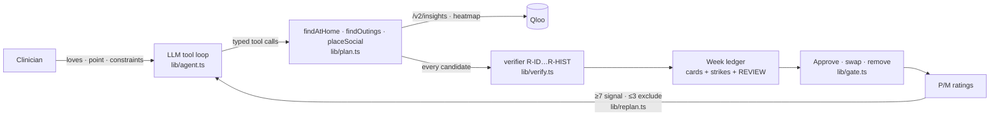

<p align="center">
  
</p>

<h1 align="center">Rekindle</h1>

<p align="center"><b>A behavioural-activation planning agent for clinicians.</b><br>
It turns what a depressed patient used to love into a week of real, open, nearby activities, verified with Qloo, approved by the clinician, and re-planned from the patient's own pleasure ratings.</p>

<p align="center">
  
</p>

<p align="center">
  <a href="https://rekindle-one.vercel.app"><b>Try it live: rekindle-one.vercel.app</b></a> (no login, fictional cases) ·
  <a href="DEMO.md">Demo steps + bench</a> ·
  <a href="DX-REPORT.md">Qloo DX report</a> ·
  <a href="ARCHITECTURE.md">Architecture</a>
</p>

<p align="center">
  
  
  
  
  
</p>

## 🎯 The number

<!-- bench:killer:start -->
**73.4% vs 9.1% through the same address pipeline** (0.0% when Rekindle's cards are checked by their Qloo ID). Across 20 fictional profiles, 58 of 79 outing venues in plans from the same LLM asked for named places were wrong: 48 unverifiable, 9 closed at the slot, 1 serving alcohol to a patient in recovery. Rekindle: 6 of 66 through the same pipeline (all 6 unverifiable, i.e. geocode or name-match misses on venues Qloo verified), 0 of 66 by Qloo ID (`bench/results.json`, run 2026-10-07 13:11 UTC).
<!-- bench:killer:end -->

The rest of the bench is in [DEMO.md](DEMO.md#bench-reproduce): the full table, the B-sym noise floor, the alcohol-screen ablation, latency, and re-plan responsiveness. It also says how to read it. Qloo grades both arms, and the manual audit was not blind.

## 🩺 The problem

Behavioural activation (BA) is a first-line, low-cost treatment for depression. Its core step is **activity scheduling**: plan specific pleasant activities for specific times, then rate them. That step breaks where it matters most:

- **Anhedonic patients cannot name anything they would enjoy**, so the session goes to brainstorming.
- **Generic suggestions** ("go for a walk") do not stick.
- When a clinician does name a real place, **nobody checks** that it is open at the planned hour, close enough for a low-energy day, within budget, quiet enough, or alcohol-free for a patient in recovery.

## ✨ What it does

1. **Intake.** The clinician enters 3–6 things the patient loved before the illness. Each is resolved to a Qloo entity or tag, typed so the clinician can tell them apart. The clinician also sets a neighbourhood point, an energy level and constraints (*in recovery*, *quiet*, *wheelchair entrance*, distance, budget).
2. **A graded week, built by an agent.** An LLM tool loop works through an energy ladder: 10-minute at-home doses (an artist, podcast, book or show), then solo outings, then one social outing placed in the top-affinity taste cell near the patient, taken from a Qloo heatmap.
   The model picks *where to look* and writes one coaching line per card. **It never names a venue.**
3. **Every candidate is verified.** Deterministic rules check what Qloo returned: open at the slot, near, within budget, an activity category, alcohol-free in recovery (exact tags plus a token screen), quiet or accessible when required, and not rated low before.
   Refused candidates **stay on the sheet, struck through, with their rule**. Ambiguous ones go to the clinician in a dashed REVIEW box.
4. **The clinician gate.** Approve, swap (re-runs that one slot live) or remove each card, then **Approve week**. Nothing reaches the patient without approval. A patient sheet prints only the approved activities.
5. **Ratings → re-plan.** Pleasure and mastery are rated 0–10. A rating ≥7 becomes a Qloo signal for week 2, and a rating ≤3 becomes an exclusion. The diff draws an ember thread from a rated activity to each week-2 card where Qloo's explainability names it as the strongest input.

Every card carries a **because** line with Qloo's per-love explainability weights, for example "because Phoebe Bridgers 0.54 · Fleabag 0.46".

## 🧠 Why Qloo is the engine

Without Qloo, the plan is an LLM naming venues it cannot verify. In the bench, the same model asked for named places produced the arm-A row of the table above.

Rekindle depends on these parts of the Qloo API:

- `/v2/insights` place queries with `signal.interests.entities` / `.tags`, `filter.location` (WKT POINT) + `filter.location.radius`, `filter.hours`, `filter.price_level.max`, `filter.tags` + `operator.filter.tags`, `filter.exclude.tags`, `filter.exclude.entities`, `feature.explainability`;
- `urn:heatmap` with `output.heatmap.boundary=urn:geohash` → `filter.location.geohash` for the social outing;
- four at-home entity types;
- `/entities` to re-check, live, the enjoyed activity a re-plan keeps in its slot;
- `/search` and `/v2/tags` at intake ([`/cases/new`](https://rekindle-one.vercel.app/cases/new)).

<!-- arch:qloo:start -->
The plan loop (every plan, re-plan, swap and toggle) can send up to 16 distinct Qloo parameters to `/entities` and `/v2/insights`; which ones a given plan sends depends on its constraints (quiet and wheelchair add `filter.tags`, a re-plan adds `/entities`), and [`/integrations/qloo`](https://rekindle-one.vercel.app/integrations/qloo) counts what the latest live plans actually sent. Intake, the health check and the bench grader add `/search` and `/v2/tags` and 4 more parameters (20 in all, to 4 endpoints). Both lists are generated from the code in [ARCHITECTURE.md](ARCHITECTURE.md#agent-tools-and-qloo-surface).
<!-- arch:qloo:end -->

Every request behind every plan is shown on [`/integrations/qloo`](https://rekindle-one.vercel.app/integrations/qloo), without the key.

## 🔍 For judges

- **Click path (about 4 min):** [DEMO.md](DEMO.md). The short version: open the live app → **Plan Maya's week, live** → toggle **In recovery** → **swap** a card → **Approve week** → rate 3 cards → **Re-plan week 2** → **Patient sheet**.
- **Receipts:** [`/judge`](https://rekindle-one.vercel.app/judge). It has the six edge states with live start buttons (loading, refused, REVIEW, empty, coverage refusal, Qloo unavailable), plus the bench, ablation and re-plan N/N, all read from the committed `bench/*.json`.
- **Nothing on the default path is replayed.** Every plan, re-plan, swap and toggle calls Qloo live; plans and re-plans also call the routing model. Captured Qloo responses are used only in unit tests (`tests/replay.ts`).

## 🏗️ How it's built



- **Next.js 15** (App Router, TypeScript) on Vercel. The UI and API routes are one deploy, and week plans stream to the browser as Server-Sent Events.
- **Agent:** Vercel AI SDK `generateText` with typed zod tools. The model is `qwen3.8-flash` on DashScope-intl with thinking off; Groq `openai/gpt-oss-120b` is the automatic fallback.
  Constraints never come from the model: radius, price, recovery, quiet and wheelchair are applied from the stored case on every request.
- **Store:** a private Vercel Blob store (one zod-validated JSON document per case, plan, and plan call log); in memory for local development.
- **Rate limits:** public / judge / bench namespaces, so judges are never locked out and the bench never touches the public quota.

Full detail, with route, module and rule tables generated from the code: [ARCHITECTURE.md](ARCHITECTURE.md).

## ✅ Tests and checks

- **158 tests** (Vitest, 13 files) cover the verifier rules against captured Qloo shapes, the agent loop's truth boundary (incl. COACH-ALC), constraint toggles, the clinician gate (and its memory across weeks), re-plan math (incl. the kept activity), rate limits, the store, health, and the view helpers.
- `npm run check` runs typecheck, lint, the tests, the seed-data check, and checks that `ARCHITECTURE.md` and the bench numbers in this README and DEMO.md still match the code and `bench/*.json`.
- **End-to-end** (Playwright, logged-out, against the live deploy):
  - `scripts/ui_smoke.py` drives the whole flow, including the patient sheet and 375 px layouts.
  - `scripts/edge_states.py` checks the six edge states.
  - Both exit 1 on a failed gate.

## ⚙️ Setup (clean environment)

Requires Node ≥ 22 and Python 3 (for the scripts).

```bash
git clone https://github.com/edycutjong/rekindle && cd rekindle
npm ci
cp .env.example .env.local     # fill in QLOO_API_KEY and QWEN_API_KEY (or GROQ_API_KEY with LLM_PROVIDER=groq)
npm run check                  # typecheck + lint + tests + seed check + docs check; needs no keys
npm run dev                    # http://localhost:3000
```

- **Without `BLOB_READ_WRITE_TOKEN`**, plans and rate-limit counters live in memory. Restarting the dev server clears them.
- **The judge and bench quotas** need `JUDGE_TOKEN` / `BENCH_TOKEN` (16 or more characters). Without them, every request uses the public namespace.
- **The Qloo key only works against `https://hackathon.api.qloo.com`.** Every variable is listed in [`.env.example`](.env.example).

## ⚠️ Limitations

- **It is not a clinical tool.** It is clinician support only: no diagnosis, no efficacy claims, no patient logins. Every case in the app is fictional. Only taste entities and a map point are sent to Qloo, never health data.
- **The plan depends on Qloo's coverage.** In thin areas, outing slots stay empty and the app shows a coverage refusal. It does not guess.
  In the bench, 4 of 20 profiles had too few verified week-1 outings for the re-plan check and are excluded (`bench/replan.json`).
- **A plan is slow:** p50 is about 17 s from click (see the latency table in DEMO.md). It meets the 30 s gate we set, but not the 15 s we aimed for. The LLM coaching step dominates.
- **Opening hours come from Qloo.** A venue whose hours are wrong upstream will pass R-OPEN. Missing hours are refused, never assumed open.
- **The alcohol screen is a deny list.** It is measured (see the ablation), but a venue that serves alcohol and carries none of the tags or keywords would get through.
- **The ember thread is Qloo's attribution, not causation.** It is drawn when a rated activity is a week-2 card's top-weighted explainability input.
- **Not built yet:** free-text address geocoding at intake (seeded neighbourhood points only), the heatmap map tile, mastery-driven rung changes (mastery is recorded and shown, but does not change the plan), multi-clinician use.

## 🤦 What we got wrong

- **We trusted `filter.exclude.tags` at first.** Excluding four bar tags still left 17 of 25 alcohol-tagged places for Maya's query (DX-REPORT §2). We added a 14-tag set and a deterministic screen, and the ablation now measures what each layer does.
- **We planned a substring alcohol screen.** A probe showed it would refuse `espresso_bar` and `independent_publishing` ("pub"), so R-ALC matches exact tag IDs and whole tokens, with an allow list (`lib/verify.ts`).
- **A beer hall got through.** The bench placed "TeKu Tavern + Café" for a profile not in recovery, because its `cafe` category passed R-KIND. Drinking-establishment categories are now refused for every case (`tests/verify.test.ts`).
- **REVIEW-only venues were being struck as refusals after a constraint toggle.** They now go to the clinician's REVIEW box.
- **The coverage refusal said "within 1.5 km" while the model had narrowed one query to 600 m.** A narrowed query that verifies nothing is now retried once at the case radius, and the empty reason names the radius queried.
- **The manual audit was done by the build agent, so it was not blind.** It is labelled as such everywhere. An external blind audit has been requested.

## 📄 License

MIT. See [LICENSE](LICENSE).
